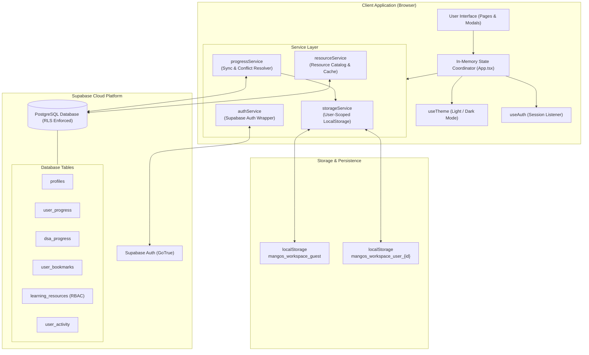

# MANGOS — Career Preparation Platform

[](https://react.dev/)
[](https://www.typescriptlang.org/)
[](https://vitejs.dev/)
[](https://tailwindcss.com/)
[](https://supabase.com/)
[](#license)

> **Master the technical interview and accelerate your path to top engineering teams.**

MANGOS is a focused, student-centric career preparation web application engineered to help aspiring software engineers, computer science students, and career transitioners build the technical muscle, system design acumen, and strategic readiness required for elite technology companies.

The name **MANGOS** represents six industry-defining engineering organizations:
- **M** — Meta
- **A** — Anthropic
- **N** — NVIDIA
- **G** — Google
- **O** — OpenAI
- **S** — SpaceX

Instead of navigating fragmented roadmaps, disconnected practice sheets, and paywalled courses, MANGOS unifies targeted algorithmic practice, company-specific interview breakdowns, curriculum roadmaps, AI-driven skill gap evaluations, and a verified, monthly-updated learning resources library into a single, nature-inspired workspace.

---

## Table of Contents

- [Live Application](#live-application)
- [Key Features](#key-features)
- [Design System & UI](#design-system--ui)
- [System Architecture](#system-architecture)
- [Technology Stack](#technology-stack)
- [Project Directory Structure](#project-directory-structure)
- [Getting Started](#getting-started)
- [Environment Configuration](#environment-configuration)
- [Database Architecture & Migrations](#database-architecture--migrations)
- [Available Scripts](#available-scripts)
- [Authentication & Account Isolation](#authentication--account-isolation)
- [Security Model](#security-model)
- [Deployment](#deployment)
- [Product Roadmap](#product-roadmap)
- [Contributing](#contributing)
- [License](#license)
- [Acknowledgements](#acknowledgements)
- [Project Links](#project-links)

---

## Live Application

The production application is deployed and publicly accessible:

**Live Demo URL**: [https://mangos-career-platfo-49mz.bolt.host](https://mangos-career-platfo-49mz.bolt.host)  
**GitHub Repository**: [https://github.com/yash-6767/MANGO](https://github.com/yash-6767/MANGO)

> *Note for contributors: Application screenshots are not bundled directly inside the source tree to preserve repository size. Refer to the live deployment link above to explore the visual interface in real time.*

---

## Key Features

MANGOS comes with an extensive suite of fully implemented capabilities:

### 1. Personalized Student Dashboard
- **Active Focus Indicator**: Displays the student's selected target company, target role, and preferred programming language.
- **Dynamic Velocity Metrics**: Live completion percentage across career roadmaps, tracked problem counts (Solved / Attempted), and an active learning streak tracker.
- **Quick Jump Hub**: Immediate entry points into daily practice sessions, roadmaps, and curated learning material.

### 2. DSA Practice & Problem Tracker
- **Company & Topic Tagging**: Algorithmic questions mapped to specific company interview loops (Meta, Anthropic, NVIDIA, Google, OpenAI, SpaceX) and domain topics (Arrays & Strings, Graph Traversal, Systems, DP, Concurrency, ML Foundations).
- **Multi-Dimensional Filters**: Filter problems by topic, difficulty (*Easy*, *Medium*, *Hard*), company focus, and search query.
- **Tri-State Status Tracking**: Toggle questions through *Not started*, *Attempted*, and *Solved* with automatic sync to local storage and Supabase cloud.
- **In-Depth Question Modals**: Embedded company details, time-to-solve benchmarks, and solution planning prompts.

### 3. Company Preparation Playbooks
- **In-Depth Company Profiles**: Dedicated architectural insights, engineering focus overviews, and interview expectations for Meta, Anthropic, NVIDIA, Google, OpenAI, and SpaceX.
- **Loop-by-Loop Breakdown**: Detailed preparation steps covering Coding Fundamentals, System Architecture, Low-Level / Hardware-Aware Concurrency, Model Evaluations, and Values Alignment.

### 4. Career Roadmaps
- **Specialized Tracks**: Multi-discipline structured milestones for:
  - *Software Engineering* (Fundamentals, Algorithms, System Design, Behavioral)
  - *Data Science* (Statistics, SQL Data Modeling, ML Foundations, Case Studies)
  - *AI / ML Engineering* (Linear Algebra, PyTorch & Transformers, Distributed Training, Model Alignment)
  - *Backend Development* (API Design, Databases & Caching, Distributed Systems, Observability)
- **Interactive Checklists**: Persisted milestone progression providing visual evidence of job readiness.

### 5. Curated Learning Resources Library
- **Verified Free Catalog**: A hand-curated catalog of verified free courses, interactive sandboxes, and open documentation across 13 distinct computer science domains (e.g., CS50, freeCodeCamp, roadmap.sh, NeetCode, The Odin Project, System Design Primer).
- **Granular Access Filters**: Filter by *100% Free*, *Free Course*, *Free with Optional Certificate*, and *Free Tier Available*.
- **Freshness & Audit Safeguards**: Resources unverified for more than 90 days are automatically flagged with an amber "Needs Audit" badge.
- **Bulk JSON Import & Export**:
  - Export the current resource library to a clean JSON document for offline backup.
  - Import external resource batches with an integrated 4-tier validator (schema compliance, HTTPS URL checks, domain/name duplication prevention, and intra-batch collision screening).
- **Role-Based Publishing (RBAC)**: Administrators can publish resources directly to the global database; students and guests can add and manage custom resources in their private workspace.

### 6. Mock Interview Simulator
- **Configurable Interview Rounds**: Simulate technical rounds customized to company and track.
- **Interactive Response Engine**: Enter technical solutions and structured reasoning under simulated time constraints.
- **Multi-Pillar Feedback Report**: Generates directional diagnostic scoring across Technical Depth, Architectural Clarity, Communication, and Edge Case Analysis.

### 7. Skill Gap Analyzer
- **Target Role Benchmarking**: Evaluates your current skills against company job specifications.
- **Actionable Visual Diagnosis**: Highlights mastery levels in core competencies (Data Structures, System Design, Concurrency, Product Thinking, API Architecture) with prioritized recommendations for improvement.

### 8. Resume ATS Scanner
- **Job Description Keyword Alignment**: Paste candidate resumes alongside target job specifications to inspect ATS compatibility scores.
- **Gap Highlighting**: Pinpoints missing core keywords, metrics-driven bullet recommendations, and formatting optimizations.

### 9. Unified Revision Bookmarks
- **Cross-Domain Revision Hub**: A centralized tabbed screen consolidating bookmarked algorithmic questions and saved external learning materials into an easily accessible review list.

### 10. Multi-Account Isolation & Cloud Synchronization
- **Guest Mode (Offline-First)**: Complete access to all features without an account; state is isolated to `mangos_workspace_guest`.
- **User-Scoped Local Storage**: Authenticated sessions persist to `mangos_workspace_user_${userId}`, ensuring multiple users on the same machine never contaminate one another's progress.
- **Non-Destructive Union Merge**: When a guest signs up or logs in, genuine local progress (solved questions, milestones, bookmarks) merges seamlessly into their remote Supabase profile without overwriting newer cloud records.
- **Reactive Sync Status**: Topbar status badge reflects live connection health (`Cloud Synced`, `Syncing...`, `Local Storage`, `Sync Pending (Retry)`).

---

## Design System & UI

MANGOS utilizes a bespoke, calm, nature-inspired visual design implemented entirely via semantic CSS variables and Tailwind utility classes.

### Color Tokens

| Token Name | Light Mode Value | Dark Mode Value | Usage |
| :--- | :--- | :--- | :--- |
| `--bg-primary` | `#F4F0E6` (Warm Beige) | `#0F1612` (Deep Forest) | Page background |
| `--bg-secondary` | `#FAF8F2` (Light Cream) | `#151F19` (Forest Secondary) | Sub-sections, panels, headers |
| `--bg-card` | `#FFFFFF` (White) | `#1A2620` (Card Forest) | Interactive cards, modal surfaces |
| `--bg-muted` | `#E6DDC8` (Muted Beige) | `#22332A` (Muted Forest) | Inactive tabs, hover fills |
| `--border-color` | `#DDDCCF` (Soft Sand) | `#2A3E34` (Deep Border) | Dividers, card boundaries |
| `--text-main` | `#24332B` (Dark Spruce) | `#EEF4F0` (Off-white Frost) | Primary typography, headings |
| `--text-muted` | `#68766C` (Sage Grey) | `#95A79C` (Muted Sage) | Captions, timestamps, metadata |
| `--emerald-primary` | `#176B50` (Emerald Green) | `#29A078` (Vibrant Emerald) | Primary CTAs, active links, badges |
| `--emerald-deep` | `#104C3A` (Deep Emerald) | `#1E7558` (Deep Forest Emerald) | Active button states, emphasis |
| `--sage` | `#A8B5A0` (Sage Green) | `#5A7566` (Muted Sage) | Accent outlines, stat highlights |
| `--sage-soft` | `#DCE6D8` (Soft Sage) | `#1E2D24` (Dark Sage Fill) | Subtle badge backgrounds, pills |

### Layout Mechanics
- **Full-Viewport Height Flex Column**: The dashboard uses a split layout where the sidebar and main viewport independently manage scroll behavior.
- **Fixed Branding & Anchored Profile**: Sidebar branding is pinned to the top, navigation items scroll without clipping, and user account actions remain anchored at the bottom.
- **Mobile Responsive Drawer**: Collapsible off-canvas mobile menu with backdrop blur on smaller viewport sizes (`<1024px`).

---

## System Architecture

MANGOS is structured as a modular, client-driven Single Page Application (SPA) designed to function offline while synchronizing with a hardened Supabase backend when credentials are provided.



---

## Technology Stack

| Category | Technology | Version | Purpose in MANGOS |
| :--- | :--- | :--- | :--- |
| **Core Framework** | [React](https://react.dev/) | `^18.3.1` | Component-based interactive user interface |
| **Runtime / Typing** | [TypeScript](https://www.typescriptlang.org/) | `^5.5.3` | Type safety, domain model definitions, and compiler checks |
| **Build Tooling** | [Vite](https://vitejs.dev/) | `^7.3.7` | High-speed ESM development server and production bundler |
| **Styling** | [Tailwind CSS](https://tailwindcss.com/) | `^3.4.1` | Utility-first responsive design and custom design token mapping |
| **CSS Processing** | [PostCSS](https://postcss.org/) & [Autoprefixer](https://github.com/postcss/autoprefixer) | `^8.4.35` / `^10.4.18` | CSS vendor prefixing and modern syntax polyfilling |
| **Iconography** | [Lucide React](https://lucide.dev/) | `^0.446.0` | Accessible, consistent vector iconography |
| **Backend & Database** | [Supabase](https://supabase.com/) | `^2.57.4` | Managed PostgreSQL database, Row Level Security, and Realtime |
| **Authentication** | [Supabase Auth](https://supabase.com/auth) | Integrated | Email/password sign-up, session persistence, and password recovery |
| **Code Quality** | [ESLint](https://eslint.org/) | `^9.9.1` | Code linting and React Hooks rules enforcement |
| **Testing** | [Node.js Test Runner](https://nodejs.org/api/test.html) | Built-in | Native ESM testing for storage isolation and security validation |

---

## Project Directory Structure

```
MANGO/
├── .bolt/                             # Bolt cloud workspace configuration
├── scripts/
│   └── verify-security-and-isolation.mjs  # Automated test suite for storage isolation & RBAC
├── src/
│   ├── components/
│   │   ├── auth/                      # Authentication & onboarding modals
│   │   │   ├── AuthModal.tsx          # Sign-in, sign-up, password recovery tabs
│   │   │   └── OnboardingModal.tsx    # First-login student profile personalization
│   │   ├── common/                    # Shared reusable presentation components
│   │   │   ├── EmptyState.tsx         # Unified placeholder for empty lists
│   │   │   ├── Modal.tsx              # Accessible dialog overlay wrapper
│   │   │   ├── PageHeader.tsx         # Standardized page headers with action slots
│   │   │   └── StatCard.tsx           # KPI metrics card with trend indicators
│   │   ├── layout/                    # Shell and layout navigation
│   │   │   └── Topbar.tsx             # Header bar, sync indicator, theme switch, avatar
│   │   ├── LearningResources/         # Curated learning resources library module
│   │   │   ├── LearningResourcesView.tsx  # Catalog view, category chips, search
│   │   │   ├── ResourceCard.tsx       # Resource card with status badges and audit warnings
│   │   │   ├── ResourceFilters.tsx    # Multi-dimensional filter toolbar
│   │   │   ├── ResourceFormModal.tsx  # Add / edit resource modal
│   │   │   └── ResourceImportModal.tsx# Bulk JSON validator and import preview
│   │   └── Sidebar.tsx                # Fixed-height independently scrollable navigation
│   ├── data/
│   │   ├── initialResources.ts        # Built-in verified seed learning resources
│   │   └── mangosData.ts              # Problems, milestones, and company interview schemas
│   ├── hooks/
│   │   ├── useAuth.ts                 # Supabase session lifecycle subscriber
│   │   └── useTheme.ts                # Dual-mode (Light/Dark) persistent theme hook
│   ├── lib/
│   │   └── supabase.ts                # Supabase client instantiation and config check
│   ├── pages/                         # Core top-level page views
│   │   ├── Bookmarks.tsx              # Consolidated DSA and learning bookmarks hub
│   │   ├── Companies.tsx              # Company interview preparation playbooks
│   │   ├── Dashboard.tsx              # Main student dashboard
│   │   ├── DSA.tsx                    # Algorithmic practice problem hub
│   │   ├── MockInterview.tsx          # Timed interview simulation and reports
│   │   ├── Profile.tsx                # Student settings, target role, sign out
│   │   ├── ResumeAnalyzer.tsx         # ATS keyword scanner and score analyzer
│   │   ├── Roadmaps.tsx               # Career milestones checklist
│   │   └── SkillGap.tsx               # Target role competency gap analyzer
│   ├── services/
│   │   ├── authService.ts             # Authentication operations API
│   │   ├── progressService.ts         # Milestones, questions, bookmarks & cloud sync
│   │   ├── resourceService.ts         # Learning resources persistence & RBAC publisher
│   │   └── storageService.ts          # User-scoped localStorage & legacy migration
│   ├── types/
│   │   ├── resources.ts               # Learning resource TypeScript interfaces
│   │   └── user.ts                    # UserProfile, WorkspaceState, Question types
│   ├── utils/
│   │   └── resourceUtils.ts           # URL verification, date diffing, JSON import validator
│   ├── App.tsx                        # Root application coordinator and router
│   ├── index.css                      # CSS custom properties and design tokens
│   ├── main.tsx                       # React DOM entrypoint
│   └── vite-env.d.ts                  # Vite client type declarations
├── supabase/
│   └── migrations/                    # Safe, version-controlled PostgreSQL migrations
│       ├── 20261026054858_create_mangos_progress.sql
│       ├── 20261126044148_create_mangos_workspace_state.sql
│       ├── 20261126160000_secure_and_normalize_schema.sql
│       └── 20261126170000_resource_admin_and_hardening.sql
├── eslint.config.js                   # Flat ESLint configuration
├── index.html                         # SPA HTML entry point
├── package.json                       # Project metadata, scripts, and dependencies
├── tailwind.config.js                 # Tailwind color mapping and theme extensions
├── tsconfig.app.json                  # TypeScript compiler options for application code
└── vite.config.ts                     # Vite build and plugin configuration
```

---

## Getting Started

### Prerequisites

Ensure you have the following installed on your machine:
- **Node.js**: `v18.0.0` or higher (Recommended: `v20.x` or `v22.x LTS`)
- **Package Manager**: `npm` (`v9.x` or higher) or `pnpm`
- **Git**: For version control

### Installation & Local Setup

1. **Clone the repository**:
   ```bash
   git clone https://github.com/yash-6767/MANGO.git
   cd MANGO
   ```

2. **Install project dependencies**:
   ```bash
   npm install
   ```

3. **Configure Environment Variables** (Optional for local testing; Guest Mode works without configuration):
   ```bash
   cp .env.example .env
   ```
   *(Populate your `.env` with your Supabase project credentials if testing cloud synchronization)*.

4. **Start the local development server**:
   ```bash
   npm run dev
   ```

5. **Open in your browser**:
   Navigate to `http://localhost:5173` to explore MANGOS.

---

## Environment Configuration

MANGOS operates gracefully in **Guest Mode** if no environment variables are provided. To connect your own Supabase cloud database, configure the following variables in a `.env` file at the root of the project:

### Environment Variables Schema

| Variable Name | Required | Type | Purpose |
| :--- | :--- | :--- | :--- |
| `VITE_SUPABASE_URL` | Optional | Public URL | The API gateway URL of your Supabase project (e.g. `https://xyz.supabase.co`) |
| `VITE_SUPABASE_ANON_KEY` | Optional | Public Key | The public anonymous (`anon`) client key for executing RLS-enforced queries |

> [!CAUTION]
> **Never commit `.env` files or expose Supabase `service_role` secrets.** `VITE_SUPABASE_ANON_KEY` is meant to be public and is constrained by PostgreSQL Row Level Security policies. Private database passwords and service keys must never be placed in frontend code.

### Example `.env.example`

```env
# Supabase Configuration (Client-side)
VITE_SUPABASE_URL=https://your-project-id.supabase.co
VITE_SUPABASE_ANON_KEY=eyJhbGciOiJIUzI1NiIsInR5cCI6IkpXVCJ9...
```

---

## Database Architecture & Migrations

The database layer runs on PostgreSQL managed via Supabase with Row Level Security (RLS) active across all tables.

### Normalized Tables

1. **`public.profiles`**:
   - `id (UUID, PK)`: Foreign key linking to `auth.users(id)` with cascading delete.
   - `full_name (TEXT)`, `university (TEXT)`, `target_role (TEXT)`, `target_company (TEXT)`.
   - `preferred_language (TEXT)`, `experience_level (TEXT)`, `role (TEXT)` (`student`, `mentor`, `admin`).
   - `created_at`, `updated_at`.
2. **`public.user_progress`**:
   - Tracks career milestone completions per user with unique constraint `(user_id, milestone_id)`.
3. **`public.dsa_progress`**:
   - Tracks question completion status (`Not started`, `Attempted`, `Solved`), notes, and timestamps with unique constraint `(user_id, question_id)`.
4. **`public.user_bookmarks`**:
   - Stores user-saved questions and learning resources with unique constraint `(user_id, item_id, item_type)`.
5. **`public.learning_resources`**:
   - Global catalog of curated resources (`id`, `name`, `official_url`, `provider`, `category`, `tags`, `difficulty`, `free_status`, `status`, `last_verified`, `is_featured`).
6. **`public.user_activity`**:
   - Audit trail tracking user interactions and learning streak logs.

### Database Migrations History

Apply migrations sequentially in the **Supabase Dashboard → SQL Editor**:

1. [`20261026054858_create_mangos_progress.sql`](file:///C:/Users/Yash5/.gemini/antigravity/scratch/MANGO/supabase/migrations/20261026054858_create_mangos_progress.sql): Legacy progress table setup.
2. [`20261126044148_create_mangos_workspace_state.sql`](file:///C:/Users/Yash5/.gemini/antigravity/scratch/MANGO/supabase/migrations/20261126044148_create_mangos_workspace_state.sql): Legacy single JSONB workspace persistence.
3. [`20261126160000_secure_and_normalize_schema.sql`](file:///C:/Users/Yash5/.gemini/antigravity/scratch/MANGO/supabase/migrations/20261126160000_secure_and_normalize_schema.sql): Hardens legacy tables, introduces normalized schema (`profiles`, `user_progress`, `dsa_progress`, `user_bookmarks`, `learning_resources`), creates automated profile trigger on user creation, and enforces strict `auth.uid() = user_id` policies.
4. [`20261126170000_resource_admin_and_hardening.sql`](file:///C:/Users/Yash5/.gemini/antigravity/scratch/MANGO/supabase/migrations/20261126170000_resource_admin_and_hardening.sql): Implements `public.is_admin()` helper, adds privilege escalation prevention trigger on `profiles`, and restricts `learning_resources` write permissions to verified administrators.

---

## Available Scripts

The following commands are defined in [`package.json`](file:///C:/Users/Yash5/.gemini/antigravity/scratch/MANGO/package.json) and can be executed via `npm`:

| Command | Purpose |
| :--- | :--- |
| `npm run dev` | Starts the local Vite development server with Hot Module Replacement (HMR). |
| `npm run build` | Compiles TypeScript and builds production-ready minified bundles into `/dist`. |
| `npm run preview` | Serves the production build locally for pre-deployment inspection. |
| `npm run typecheck` | Executes TypeScript static type-checking (`tsc --noEmit -p tsconfig.app.json`). |
| `npm run lint` | Runs ESLint across all source files to verify code quality and hook safety. |
| `node --test scripts/verify-security-and-isolation.mjs` | Executes the native Node test suite verifying storage isolation, demo rejection, and RBAC rules. |

---

## Authentication & Account Isolation

MANGOS incorporates an offline-first storage and synchronization pipeline to protect privacy and support seamless account transitions:

### 1. Dual-Tier Storage Isolation
- **Guest Namespace**: When using MANGOS without signing in, all progress is written to `localStorage.getItem('mangos_workspace_guest')`.
- **User Namespace**: Once signed in, data is written to a key derived from the user's UUID: `mangos_workspace_user_${userId}`.
- **Account Switching Protection**: Signing out preserves the logged-out user's local cache but resets the active application state to a neutral guest state. A second user logging in on the same browser cannot view the previous user's profile, solved problems, or bookmarks.

### 2. Conflict-Free Synchronization
Upon authentication, the application resolves data using an ordered, non-destructive flow:
1. **Remote-First Retrieval**: Loads the authenticated user's remote records from Supabase as the initial source of truth.
2. **Guest Validation**: Runs `isGenuineGuestData(guestState)` to confirm whether genuine guest progress exists (ignoring unconfigured states and mock demo data).
3. **Union Merge**: New items created during the guest session (solved DSA problems, completed roadmap milestones, newly added bookmarks) are combined using a mathematical set union with cloud records.
4. **Cloud Write & Guest Evacuation**: The merged result is persisted to Supabase and the temporary guest cache is evacuated.

---

## Security Model

- **Row Level Security (RLS)**: Enforced directly at the PostgreSQL layer. Users can only select, insert, update, or delete records where `auth.uid() = user_id`.
- **Role-Based Access Control (RBAC)**: Modifications to the global learning resource catalog require administrative privileges (`public.is_admin() = true`). Regular students retain write access strictly over their own workspace.
- **Privilege Escalation Prevention**: A database trigger aborts any unauthorized attempt by standard users to modify their own `role` column in `public.profiles`.
- **Strict HTTPS & Safe Hyperlinks**: External resource URLs must begin with `https://`. External links are opened with `rel="noopener noreferrer"` and `target="_blank"`.
- **Client-Side Key Hygiene**: Only public Supabase credentials (`VITE_SUPABASE_ANON_KEY`) are utilized in the frontend bundle.

---

## Deployment

MANGOS is optimized for deployment on modern static hosting platforms such as Vercel, Netlify, or Bolt.

### Deploying to Vercel

1. Push your latest commits to your GitHub repository:
   ```bash
   git push origin main
   ```
2. Log in to [Vercel](https://vercel.com/) and click **Add New Project**.
3. Import your `MANGO` repository.
4. Set the build configuration:
   - **Framework Preset**: `Vite`
   - **Build Command**: `npm run build`
   - **Output Directory**: `dist`
   - **Install Command**: `npm install`
5. Under **Environment Variables**, add:
   - `VITE_SUPABASE_URL`: Your Supabase project URL
   - `VITE_SUPABASE_ANON_KEY`: Your Supabase anonymous key
6. Click **Deploy**.

---

## Product Roadmap

### Implemented (v1.0)
- [x] Nature-inspired dual-mode design system (Warm Beige / Sage / Emerald & Deep Forest).
- [x] Fixed-height layout with independent sidebar scrolling.
- [x] Algorithmic practice problem hub with multi-company & topic filtering.
- [x] Company preparation playbooks for Meta, Anthropic, NVIDIA, Google, OpenAI, and SpaceX.
- [x] Multi-track career roadmaps with interactive progress tracking.
- [x] Curated learning resources library with 4-tier JSON import validator and export capability.
- [x] Timed mock interview simulator with automated rubric scoring.
- [x] Competency skill gap analyzer and ATS resume keyword scanner.
- [x] Unified revision bookmarks hub for problems and resources.
- [x] Offline-first storage isolation and conflict-free Supabase cloud synchronization.
- [x] Database RBAC and Row Level Security hardening.

### Planned Enhancements (v2.0)
- [ ] Direct Code Sandbox integration for in-browser algorithm execution (e.g., Monaco Editor + WebAssembly Pyodide).
- [ ] Peer-to-peer mock interview scheduling and room matchmaking.
- [ ] Community resource submissions with admin review and approval queue.
- [ ] Native mobile wrapper using Capacitor or React Native.
- [ ] Expanded company playbooks (Apple, Microsoft, Amazon, Netflix).

---

## Contributing

We welcome contributions from students, engineers, and educators! To contribute:

1. **Fork the Repository**:
   Click the **Fork** button at the top-right of the repository page.

2. **Clone your fork**:
   ```bash
   git clone https://github.com/<your-username>/MANGO.git
   cd MANGO
   ```

3. **Create a feature branch**:
   ```bash
   git checkout -b feature/your-feature-name
   ```

4. **Make and verify your changes**:
   Ensure all type checks, linting, and automated tests pass:
   ```bash
   npm run typecheck
   npm run lint
   npm run build
   node --test scripts/verify-security-and-isolation.mjs
   ```

5. **Commit your changes**:
   ```bash
   git commit -m "feat: add descriptive feature summary"
   ```

6. **Push to your fork and submit a Pull Request**:
   ```bash
   git push origin feature/your-feature-name
   ```
   Open a Pull Request against `yash-6767/MANGO` with a clear description of your improvements.

---

## License

This project currently has **no specified open-source license**. All rights are reserved by the repository owner ([yash-6767](https://github.com/yash-6767)). For permission inquiries or licensing requests, please contact the repository maintainer directly through GitHub.

---

## Acknowledgements

- [Lucide Icons](https://lucide.dev/) for clean and accessible vector icons.
- [Tailwind CSS](https://tailwindcss.com/) for modern utility-first CSS styling.
- [Supabase](https://supabase.com/) for database and authentication infrastructure.
- The open-source computer science education community for creating high-quality free learning materials.

---

## Project Links

- **Repository**: [https://github.com/yash-6767/MANGO](https://github.com/yash-6767/MANGO)
- **Live Platform**: [https://mangos-career-platfo-49mz.bolt.host](https://mangos-career-platfo-49mz.bolt.host)
- **Issues & Feedback**: [https://github.com/yash-6767/MANGO/issues](https://github.com/yash-6767/MANGO/issues)
